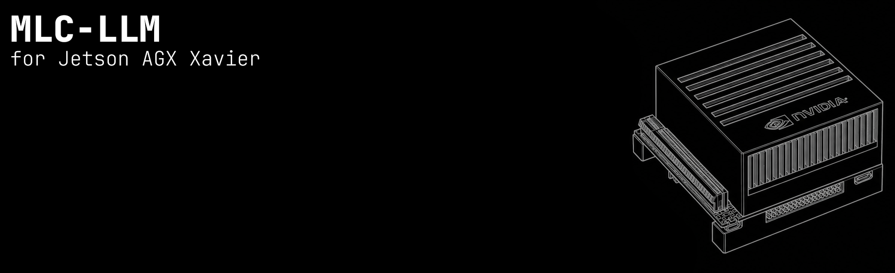

This fork runs **NVIDIA Nemotron 3.5 Bolt E4B** on **Jetson AGX Xavier 32 GB**
using JetPack 5 / CUDA 11.4. It adds DFlash speculative decoding and kernels
suited to Xavier's Volta GPU. The fastest measured configuration reaches
**395 tok/s prefill at 448 tokens**, **279 tok/s at 1,768 tokens**, and roughly
**31–34 tok/s decode**.

Based on upstream MLC-LLM `44fd06d0`. DFlash builds on
[Lev Stambler's implementation](https://github.com/Lev-Stambler/mlc-llm--DFlash/tree/b6c7bf7d269fd4127fd1a48c478b01d9dc8ff42b).
The original project overview is preserved in [README.upstream.md](README.upstream.md).

## Benchmarks: this fork versus baseline MLC

All results below run **Nemotron 3.5 Bolt E4B** on the same Xavier. Rates are
in tokens/second. Baseline uses upstream MLC with the CUDA 11.4 compatibility
fixes needed to run it, q4f16_1 weights and plain decoding. The optimized fork
uses the same target quantization, an F16 DFlash draft with two proposals,
Q8 activation kernels, and `--prefill-variant hybrid`.

| Prompt tokens | Baseline prefill | Fork prefill | Baseline decode | Fork decode | Fork decode MTP |
|---|---:|---:|---:|---:|---:|
| 161 | 108.28 | **240.79** | 11.90 | 23.24 | **31.68** |
| 448 | 115.47 | **395.16** | 10.80 | 19.63 | **34.16** |
| 1,768 | 82.66 | **278.67** | 10.06 | 17.18 | **31.10** |

**Fork decode** is the November 1 native-matrix, non-speculative control,
measured before the prefill changes (see the
[experiment record](docs/deploy/xavier_dflash.md)). **Fork decode MTP** uses
two-token DFlash speculative decoding with the final `hybrid` prefill configuration.

This compares the complete optimized configuration with the initial engine;
it includes speculative decoding and changed arithmetic. Baseline measurements
were recorded on October 31; fork measurements on November 1, 2026. The power
connection changed between sessions, and CPU compilation overlapped the initial
baseline. These are historical end-to-end engine comparisons. For an isolated
prefill comparison, the following November 1 sweep keeps the weights, compiled
model library, DFlash settings and machine configuration identical:

| Prefill implementation | 161 tokens | 448 tokens | 1,768 tokens | Long first token |
|---|---:|---:|---:|---:|
| Fork before prefill changes | 218.91 | 271.75 | 143.94 | 12.292 s |
| Skip fully masked tiles | 235.07 | 345.13 | 201.56 | 8.781 s |
| + Actual-width local heads (`width`) | 233.16 | 340.26 | 250.50 | 7.068 s |
| + Volta WMMA for current-chunk attention (`hybrid`) | **240.79** | **395.16** | **278.67** | **6.354 s** |

The combined prefill changes improve the long prompt **1.94×** and cut its
complete 128-token request from **16.354 to 10.438 seconds**. Decode stays
approximately constant. The `width` variant preserves all six measured baseline
output strings; `hybrid` changes the long forced continuation.

## Benchmarks: this fork versus llama.cpp

Both engines run **Nemotron 3.5 Bolt E4B with two DFlash proposals**, the same
prompt text and a forced 128-token output. MLC uses q4f16_1 plus Q8 activations;
llama.cpp uses Q4_K_M and the F16 draft, with CUDA offload and Flash Attention.
The tokenizer/template counts differ slightly.

| Prompt tokens MLC / llama | Fork prefill | llama prefill | Fork decode | llama decode | Fork request | llama request |
|---|---:|---:|---:|---:|---:|---:|
| 161 / 168 | **240.79** | 189.90 | **31.68** | 26.80 | **4.681 s** | 5.635 s |
| 448 / 454 | **395.16** | 316.46 | **34.16** | 25.09 | **4.856 s** | 6.511 s |
| 1,768 / 1,774 | 278.67 | **341.88** | **31.10** | 24.37 | 10.438 s | 10.427 s |

The fork is faster on short and medium complete requests. Llama prefills the
long input faster; the complete long request is effectively tied. The llama
control was recorded earlier on November 1 at revision `ddf48f85`, before the
final MLC prefill sweep. Different quantizations and arithmetic mean this is a
practical serving comparison, with no claim of equal model accuracy.

**Method:** AGX Xavier 32 GB, sm_72, MAXN, pinned clocks (GPU 1,377 MHz, CPU
2,265.6 MHz, EMC 2,133 MHz), one sequence, context 8,192, MLC chunks 512,
prefix caching disabled, greedy generation, one warmup and two measured runs
per case. Tables report means; profiler timings are excluded. Forced output
past EOS measures throughput rather than natural answer quality. Raw summaries
are in [docs/benchmarks/xavier](docs/benchmarks/xavier); detailed validation and
history are in [the experiment record](docs/deploy/xavier_dflash.md).

## Additional model: Gemma4 Unified 12B

An experimental port of the official `Gemma4UnifiedAssistantForCausalLM` also
supports native MTP trials with this target. See the
[MTP implementation, validation and build instructions](docs/deploy/xavier_gemma4_mtp.md).
It currently uses a greedy direct-VM controller with a 4K deployed context and native tool calls.
The optional HTTP adapter keeps it resident alongside Nemotron and routes
requests by model ID through one shared GPU queue.

The fork also supports text generation from
`gemma-4-12B-IT-QAT-Q4_0-unquantized-heretic`, converted from BF16 to MLC
`q4f16_1` (6.70 GB of tensors). These are **plain-decoding** results on the
same Xavier, with a 4K context, chunks of 512, one warmup and two measured
128-token runs per prompt:

| Prompt tokens | Prefill tok/s | Decode tok/s | Complete request |
|---|---:|---:|---:|
| 161 | 90.82 | 11.72 | 12.616 s |
| 448 | 109.65 | 10.59 | 16.082 s |
| 1,768 | 50.44 | 8.73 | 49.607 s |

This first port uses the fast projection kernels and generic attention;
the Nemotron-specific attention optimizations do not apply to its different
head layout. See [the 12B experiment](docs/deploy/xavier_gemma4_12b.md) for
conversion/build instructions, validation and native-MTP compatibility, and
[the saved summary](docs/benchmarks/xavier/gemma4-12b-heretic-summary.json)
for the measured means.

The experimental z-lab DFlash pairing did not accelerate this checkpoint:
**6.84 versus 11.72 tok/s** on the short prompt, with **zero accepted draft
tokens**. The 12B experiment records the input-scaling correction and remaining
compatibility investigation; these plain rates do not include speculative decoding.

## Improvements in this fork

- **CUDA 11.4 support:** pinned TVM/TIRx compatibility patches, nvcc instead of
  the newer NVRTC bindings, and a fix for exporting shared module graphs.
- **Gemma4 support:** E4B/Nemotron with two KV heads, plus a text-only Unified
  12B port with mixed local/global KV head counts and global K=V projections.
- **Native Unified MTP prototype:** official QAT assistant conversion, shared-KV
  draft steps, greedy target verification, and an optional resident HTTP adapter.
- **Resident model routing:** Nemotron shares one authenticated endpoint and
  FIFO GPU queue with either 12B + MTP or EmbeddingGemma 2 text embeddings;
  see the [resident switching PoC](docs/deploy/xavier_embedding_switch_poc.md).
- **Faster projections:** one-token GEMV specialization; FP16 dequantization +
  cuBLAS for large prefill; native DP4A/Q8-activation kernels for 1–4 rows.
- **DFlash execution:** target feature extraction, GPU greedy selection, cached
  draft K/V, bounded context attention, FP32 residual fixes and CUDA graphs.
- **Faster attention:** native 256/512-wide verification; prefill skips masked
  tiles, computes local paged heads at width 256, and optionally uses Volta
  Tensor Cores for current-chunk attention.
- **Reproducible experiments:** fixed prompts, component tests, monitored runners
  and separate prefill variants.
- **Xavier HTTPS service:** authenticated OpenAI-compatible chat and native
  Nemotron/Gemma4 tool round-trips for Pi; see the
  [deployment runbook](deploy/xavier/README.md).

## Build on Jetson AGX Xavier

### 1. System and Python environment

Tested with **JetPack 5.1.8 / L4T R35.7.0, Ubuntu 20.04, CUDA 11.4,
gcc 9.4, Python 3.12, LLVM 20.1.8 and CMake 4.4.4**. Install LLVM 20 development
packages using the [LLVM apt repository](https://apt.llvm.org/), plus a recent
Rust toolchain for the tokenizer build. Keep `/usr/local/cuda` pointed at CUDA
11.4. The system Python 3.8 is too old for this source tree.

```bash
sudo apt-get install build-essential git ccache pkg-config libssl-dev bc llvm-20-dev
# Install uv first: https://docs.astral.sh/uv/getting-started/installation/
mkdir -p ~/Workspaces
cd ~/Workspaces
git clone --recursive https://github.com/cortexist/mlc-llm.git
cd mlc-llm
uv venv --python 3.12 --seed ~/Workspaces/mlc-venv
source scripts/xavier/env.sh
uv pip install 'cmake==4.4.4' ninja 'scikit-build-core>=0.11,!=1.1.0' \
  setuptools-scm 'cython>=3.2.8' numpy ml_dtypes packaging psutil \
  datasets fastapi openai pandas prompt_toolkit requests safetensors \
  sentencepiece shortuuid tiktoken tqdm transformers uvicorn
uv pip install torch --index-url https://download.pytorch.org/whl/cpu
uv pip install --no-deps apache-tvm-ffi-orcjit==0.1.3
```

CPU PyTorch is sufficient for the conversion/validation helpers. The tested
packages were torch `2.15.0+cpu`, transformers `5.22.1` and numpy `2.5.4`.
FlashInfer starts at SM75; Xavier is SM72, so this build uses its own attention
paths. The optional source-built orcjit addon requires a newer LLVM; the tested
setup used the prebuilt 0.1.3 package above.

### 2. Build the pinned compiler stack and runtime

The recursive checkout pins TVM `629cc65820`, TIRx `198a04573e` and TVM-FFI
`6628c464e3`. Apply the included dependency patch **before building**:

```bash
source scripts/xavier/env.sh
git -C "$TIRX_SRC" apply --check "$MLC_SRC/scripts/xavier/patches/tirx-cuda114.patch"
git -C "$TIRX_SRC" apply "$MLC_SRC/scripts/xavier/patches/tirx-cuda114.patch"
bash scripts/xavier/build-all.sh
```

Apply the patch once per clean dependency checkout. It includes the CUDA launch
compatibility definitions, nvcc default and export-order fix. Build order is
FFI → TIRx → TVM → MLC. The scripts enable CUDA and cuBLAS, disable
Thrust/CUTLASS/NVTX, target architecture 72, and link pthread explicitly for
Ubuntu 20.04. Compilation defaults to two jobs. Installing all four from the
same pinned source avoids FFI ABI mismatches.

### 3. Prepare Nemotron and the DFlash draft

Place the BF16 Hugging Face checkpoint
[`nvidia/NVIDIA-Nemotron-3.5-Bolt-E4B-BF16`](https://huggingface.co/nvidia/NVIDIA-Nemotron-3.5-Bolt-E4B-BF16)
in `~/Models/nemotron-3.5-Bolt-E4B-BF16`, and its matching DFlash F16 GGUF at
`~/Models/nemotron-3.5-Bolt-E4B-4GB/Nemotron-3.5-Bolt-E4B-DFlash-F16.gguf`.
The tested draft uses block size 8, mask token 4 and target layers
`[5, 11, 17, 23, 35]` (zero-based). Keep a llama.cpp checkout at
`~/Workspaces/llama.cpp` for `gguf-py` and the comparison server.

```bash
source scripts/xavier/env.sh
export MLC_GEMMA4_TEXT_ONLY=1
mkdir -p dist/nemotron-q4 dist/libs logs
python -m mlc_llm convert_weight ~/Models/nemotron-3.5-Bolt-E4B-BF16 \
  --quantization q4f16_1 --device cuda -o dist/nemotron-q4
python -m mlc_llm gen_config ~/Models/nemotron-3.5-Bolt-E4B-BF16 \
  --quantization q4f16_1 --conv-template gemma4_instruction \
  --context-window-size 8192 --prefill-chunk-size 512 --max-batch-size 1 \
  -o dist/nemotron-q4
python scripts/prepare_xavier_dflash.py --target dist/nemotron-q4 \
  --draft ~/Models/nemotron-3.5-Bolt-E4B-4GB/Nemotron-3.5-Bolt-E4B-DFlash-F16.gguf
python -m mlc_llm convert_weight dist/draft-hf --quantization q0f16 \
  --model-type dflash --device cpu -o dist/draft
export MLC_DFLASH_CUDA_GRAPH=1 MLC_JP5_SINGLE_TOKEN=1 MLC_JP5_VERIFY_THREE=1
export MLC_JP5_Q4_CUBLAS=1
# The draft's Tensor Core compilation path uses its model-specific override.
env -u MLC_JP5_Q4_CUBLAS python -m mlc_llm compile dist/draft/mlc-chat-config.json \
  --device cuda --opt O2 -o dist/libs/draft-cached-tc-sm72.so
bash scripts/build_xavier_kernels.sh
python scripts/build_xavier_prefill.py
```

`prepare_xavier_dflash.py` exports the F16/F32 draft tensors without
requantization and reuses the converted target via local symlinks. It also
accepts `--gguf-python` for a different `gguf-py` location. Keep the original
converted target directory available. `MLC_GEMMA4_TEXT_ONLY=1` omits audio entry
points that do not compile on this target. Only text generation was qualified.

### 4. Validate and reproduce the benchmark

```bash
source scripts/xavier/env.sh
sudo nvpmodel -m 0
sudo jetson_clocks
python tests/python/op/test_xavier_prefill.py --output logs/prefill-components.json
bash scripts/run_xavier_prefill_experiments.sh
# Individual optimized run:
python scripts/bench_xavier_dflash.py --prefill-variant hybrid \
  --target-lib dist/libs/target-dflash-dp4a-attn-sm72.so --draft-tokens 2 \
  --output logs/nemotron-hybrid.json
# llama.cpp control; uses ~/Workspaces/llama.cpp/build/bin/llama-server:
python scripts/bench_xavier_llama.py --output logs/llama-control.json
```

`width` is the simpler prefill choice; `hybrid` additionally uses FP16
probabilities in WMMA attention. Both preserve the existing small-query
verification path. **108 component checks** passed, including independent
FP32 attention comparisons and three-query fallback checks. Elevated Compute
Sanitizer memcheck completed with **zero errors**. Natural-stop tests returned
`391`, the requested three summary bullets plus two risks, and `Done`.

The tested configuration is greedy, one sequence, two draft proposals, prefix
caching disabled and an 8K context. Q8 activations and WMMA change arithmetic;
broad accuracy/perplexity equivalence has not been established. Board shutdowns
also occurred during the investigation; these measurements do not establish
long-term hardware stability. Benchmark runners use temperature/memory stop
limits. Keep compilation and GPU inference sequential.

## HTTPS serving on Xavier

The optional service exposes an OpenAI-compatible API on the LAN or a
Headscale/Tailscale network. Use your own hostname, such as
`https://xavier.example.com/v1`. It supports resident Nemotron with either
the 12B/MTP adapter or the EmbeddingGemma 2 text worker. It uses a
certificate signed by a local CA, bearer authentication and streaming responses.
Requests share one GPU queue; the 12B adapter supports 4K text/tool chat, and
the embedding PoC accepts up to 128 text tokens.
See the
[deployment and client instructions](deploy/xavier/README.md) for CA trust,
credentials, service management and certificate renewal.

## Upstream and attribution

[MLC-LLM](https://github.com/mlc-ai/mlc-llm) and its contributors provide the
compiler and serving engine. DFlash was ported from Lev Stambler's fork; its
history and source attribution are retained. This repository retains the
upstream [Apache-2.0 license](LICENSE). See [README.upstream.md](README.upstream.md)
for the broader upstream project, documentation and contribution links.
