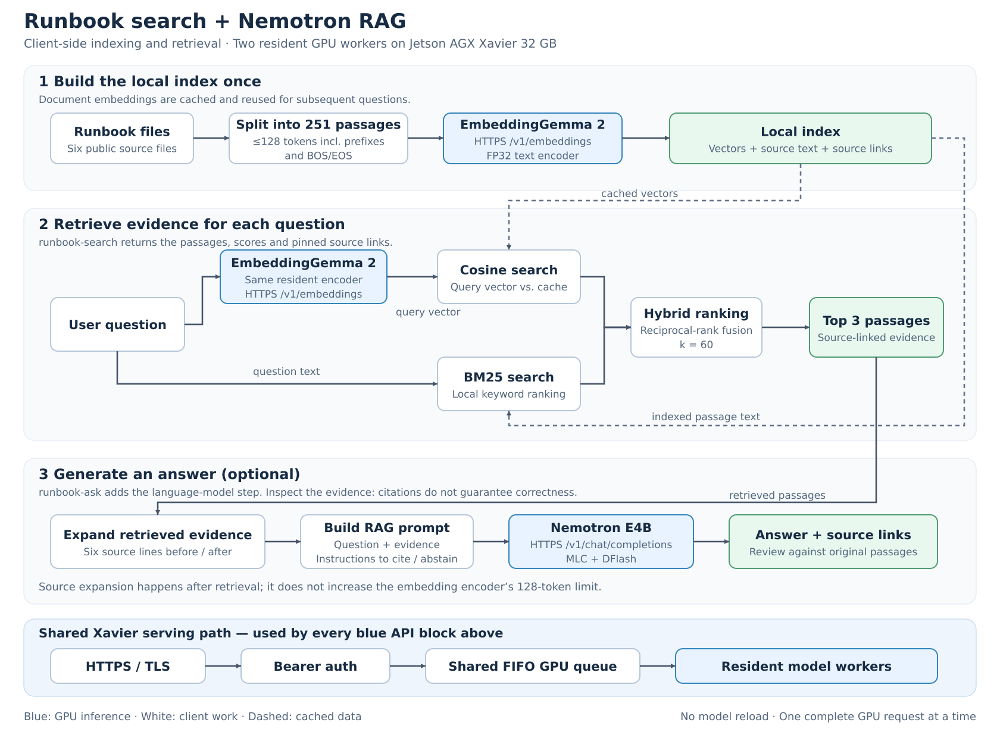

# Runbook search and Nemotron RAG on Xavier

This is a practical text-only trial of the resident EmbeddingGemma 2 and
Nemotron service: search the fork's deployment/experiment notes, then optionally
ask Nemotron to answer using the retrieved passages. All inference runs through
the existing HTTPS service. Vectors and similarity search live on the client;
no vector database, extra GPU model or server modification is required.

The pipeline works end to end, but answer reliability is still limited.
On this small development set, hybrid retrieval finds annotated evidence in
the top three for **11/16 questions**, while Nemotron gives complete correct
answers for only **8/16**. Review the source links before acting on an answer.

## System architecture



[SVG diagram](../_static/diagrams/runbook-rag-architecture.svg) ·
[Mermaid source](../_static/diagrams/runbook-rag-architecture.mmd).
The SVG is an editable layout of the same architecture; the PNG is rendered
from that SVG and needs no Mermaid support. To regenerate the PNG:

```bash
rsvg-convert -o docs/_static/diagrams/runbook-rag-architecture.png \
  docs/_static/diagrams/runbook-rag-architecture.svg
```

The two embedding calls in the diagram use the same resident encoder. All blue
API blocks pass through the shared authenticated FIFO. `runbook-search` stops
at retrieved evidence; `runbook-ask` adds the Nemotron call. Switching workers
does not reload weights.

## Corpus and evaluation method

The frozen corpus is the main README, HTTPS deployment guide, and four Xavier
experiment guides at revision `7d572781`. It contains **251 passages** from six
files. The published [snapshot](../benchmarks/xavier/runbook-rag-corpus.json)
includes original source text, SHA-256 hashes, exact character/line spans and
the actual text sent to the encoder. Links in answers point to that revision,
so later documentation edits do not silently change the evidence.

The checkpoint's tokenizer JSON determines window sizes. Every embedding
input includes the document-title prefix and two BOS/EOS tokens; measured
lengths are **47–127 tokens**, below the compiled limit of 128. Neighboring
windows overlap by 12 content tokens. These are token windows, not semantic
paragraph boundaries: they can cut sentences, code and tables. Longer files
are split rather than silently truncated. The published snapshot omits vectors;
the local cache stores normalized 768-dimensional FP32-model output vectors.

The [20 questions and evidence annotations](../benchmarks/xavier/runbook-rag-questions.json)
were written before the first full-corpus retrieval run: 16 answerable questions
and four whose requested facts are absent. Their SHA-256 is
`406773ad25e04ba168cc12fbaf6c2afa8db1bacc6578595abab9db270a67337f`.
This is an author-written development set, not an independent held-out benchmark.
The paraphrases are deliberately challenging; “tiny vector lookup,” for example,
is an ambiguous way to refer to an embedding inference request.

Retrieval compares:

- **Embeddings:** `task: search result | query: ...` for queries and
  `title: ... | text: ...` for documents; cosine similarity via local dot products.
- **BM25:** lowercase ASCII alphanumeric splitting, no stemming, `k1=1.2`,
  `b=0.75`, using the same passage titles/content and no task-prefix words.
- **Hybrid follow-up:** reciprocal-rank fusion of the top 50 from each method,
  summing `1 / (60 + rank)`. These constants were fixed before viewing the
  hybrid results. Questions, annotations, embeddings and corpus stayed unchanged.

An annotated phrase is located in the full source, then every passage covering
its midpoint is accepted as relevant. Whitespace is normalized for phrase
matching. This makes scoring reproducible, but it is a proxy: unannotated
paraphrases can be relevant, and an annotated fragment may not contain a full
explanation. Unknown questions are excluded from retrieval-rate denominators.

## Measured results

November 1, 2026, Jetson AGX Xavier 32 GB, JetPack 5.1.8 / CUDA 11.4, MAXN/fixed
clocks, cool fan profile. Both workers stayed resident. Inference requests were
sequential, with no compilation. HTTPS used the client's normal CA trust and
bearer authentication. API keys and real network identifiers are not recorded
in the public results.

| Retrieval | Top-1 evidence hit | Top-3 evidence hit | Mean reciprocal rank |
|---|---:|---:|---:|
| EmbeddingGemma 2 | 2/16 (12.5%) | 9/16 (56.25%) | 0.376 |
| BM25 | 7/16 (43.75%) | 10/16 (62.5%) | 0.533 |
| Hybrid RRF | 7/16 (43.75%) | 11/16 (68.75%) | 0.591 |

The first generation run used the embedding top three verbatim. After observing
misses and fragments, the follow-up used hybrid top three and expanded each
source by six lines before/after its matched line span. Expansion happens on
the client **after retrieval**; it does not increase the encoder's 128-token
capacity. Retrieval scores still use the original small windows. Expanded
snippets can overlap and are not deduplicated in this prototype.

Both generation runs use the same prompt: answer only from sources, cite
`[S1]`–`[S3]`, keep answers short, and decline absent facts. Nemotron uses
temperature zero and a 128-token output cap. All 40 evaluation generations
finished naturally, without hitting the cap.

| Answer review | Embedding, original windows | Hybrid, expanded sources |
|---|---:|---:|
| Complete correct answers, documented questions | 7/16 | 8/16 |
| Correct declines, absent facts | 4/4 | 4/4 |

These are **Codex manual inspections**, not independent human grading or a
model-judge score. Partial answers and declines on answerable questions do not
count as complete. Citation-label validity alone does not establish factual
support. The per-question [review](../benchmarks/xavier/runbook-rag-review.json)
explains every verdict; both full raw runs are preserved:
[embedding baseline](../benchmarks/xavier/runbook-rag-embedding-summary.json),
[hybrid follow-up](../benchmarks/xavier/runbook-rag-summary.json).

Hybrid and context expansion changed together for generation, so their separate
effects on answer quality are not isolated. Only the retrieval comparison uses
the same unchanged windows for all three methods.

## Latency

Indexing all 251 passages took **16.68 seconds**, including 100 ms pauses between
batches of eight. Summed encoder forward/output-copy time was 10.65 seconds.
The index timer excludes source extraction/tokenization and final cache writing.
This is a one-time cost, reused for later searches.

Median times in the hybrid follow-up:

| Stage | Time |
|---|---:|
| Query embedding forward + output copy | 41.57 ms |
| Query embedding complete HTTPS request | 99.11 ms |
| Client brute-force cosine search, 251 vectors | 9.36 ms |
| Client BM25 scoring/sort | 1.33 ms |
| Nemotron complete HTTPS answer request | 5.04 s |

Networking, tokenization and JSON are included in HTTPS times; the forward
timer excludes input copies/preprocessing/pooling. Local scoring ran on the
client, not Xavier. The initial embedding-only answer median was 2.79 seconds;
expanded evidence increased the median Nemotron prompt from 521 to 1,141.5
tokens. These are differing questions/outputs with one sample each, not isolated
latency ablations or a concurrent-load SLA. The earlier repeated-short-query
55–56 ms measurement is a different workload.

The service PID stayed unchanged through the trial. After evaluation, sampled
available whole-device RAM was about 17.7 GiB with no swap occupied; this is a
snapshot, not a measured peak or long-term stability qualification.

## What worked and what failed

The follow-up correctly retrieves and explains Node system CA trust,
`pi-clm` withholding file-read results, the Pi output-token override, the
two-proposal default, and shorter normalized embeddings. It declines requests
for a replacement power-adapter SKU, 32-client throughput, private ticket-search
accuracy and a production vector-database version; none are documented.

Failures are useful:

- **Semantic search alone is insufficient here.** Technical terminology and
  repeated historical benchmark sections make strong lexical matches useful.
  Embeddings help some paraphrases but are worse overall than BM25 on this set.
- **Top-three recall is not answer accuracy.** For cancellation, the supplied
  hybrid evidence explicitly says to drain GPU work before releasing the queue,
  but Nemotron still declines. For the 128-token question it misses the important
  distinction between content tokens and BOS/EOS overhead.
- **Historical state can override current state.** Hybrid supplies the later
  change to `cool`, yet Nemotron answers `quiet` from an older experiment.
  It also sometimes gives a cited but irrelevant explanation. A citation is
  not proof that the answer is correct or current.
- **Fusion can regress individual queries.** It pushes the token-postprocessing
  explanation out of the top three even though semantic-only search found it.

Next useful improvements are paragraph/function-aware chunks, explicit document
section and chronology metadata, and a larger independently labeled query set.
Do not tune a confidence threshold on these 20 questions and call it validated
abstention. This trial supports source-assisted search, not unattended factual
answers or reliable absence detection.

## Run it

The [client](../../scripts/xavier_runbook_rag.py) uses Python's standard library
except for `tokenizers` during indexing (tested with 0.23.3). Obtain only
`tokenizer.json` from your local EmbeddingGemma 2 checkpoint; weights remain on
the server. Examples use placeholders: substitute your actual endpoint and key
path. Keep the vector cache outside the Git checkout.

```bash
export XAVIER_ENDPOINT=https://xavier.example.com/v1
export XAVIER_KEY_FILE="$HOME/.config/xavier/api-key"

uv run --no-project --with tokenizers python scripts/xavier_runbook_rag.py index \
  --endpoint "$XAVIER_ENDPOINT" --key-file "$XAVIER_KEY_FILE" \
  --tokenizer-json /path/to/embeddinggemma-2/tokenizer.json \
  --revision 7d572781 --index /tmp/runbook-index.json

# Inspect passages and pinned source links without generating an answer:
python scripts/xavier_runbook_rag.py search \
  --endpoint "$XAVIER_ENDPOINT" --key-file "$XAVIER_KEY_FILE" \
  --index /tmp/runbook-index.json \
  --question 'Which setting lets Node trust the OS certificate store?'

# The same retrieval followed by a cited Nemotron answer:
python scripts/xavier_runbook_rag.py ask \
  --endpoint "$XAVIER_ENDPOINT" --key-file "$XAVIER_KEY_FILE" \
  --index /tmp/runbook-index.json \
  --question 'Which setting lets Node trust the OS certificate store?'
```

Both `search` and `ask` default to hybrid retrieval and six-line expansion.
Use `--retriever embedding|bm25|hybrid` and `--context-lines 0` to inspect raw
windows. The JSON output includes passage text, scores, revision-pinned source
links, and, for `ask`, the generated answer, usage and stage timings.

Reproduce both evaluations with the same index:

```bash
python scripts/xavier_runbook_rag.py evaluate \
  --endpoint "$XAVIER_ENDPOINT" --key-file "$XAVIER_KEY_FILE" \
  --index /tmp/runbook-index.json --retriever embedding --context-lines 0 \
  --generate --output /tmp/runbook-embedding.json
python scripts/xavier_runbook_rag.py evaluate \
  --endpoint "$XAVIER_ENDPOINT" --key-file "$XAVIER_KEY_FILE" \
  --index /tmp/runbook-index.json --retriever hybrid --context-lines 6 \
  --generate --output /tmp/runbook-hybrid.json
```

Without `--generate`, evaluation compares all three retrievers without calling
Nemotron. Five CPU checks cover token budgets/source coverage, line provenance,
evidence labels, BM25 scoring, fusion and source expansion:

```bash
uv run --no-project --with tokenizers python tests/python/serve/test_xavier_runbook_rag.py
```

The resident service and its shared FIFO remain unchanged. Both workers keep
their existing deployment limits; no new agent tool or Pi integration is
installed by the public client script.
